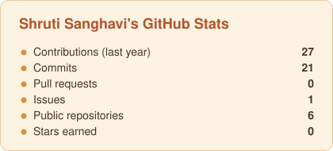
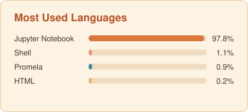
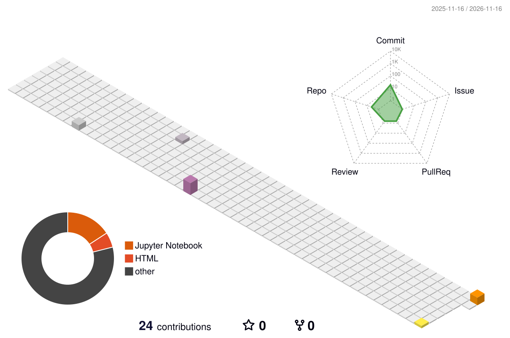

 

 

<h2 align="center">About Me</h2>

I'm a **Data Science & Big Data Analytics** graduate student who turns raw, messy data into decisions that actually matter. I build end-to-end data pipelines, apply machine learning algorithms, and extract patterns that businesses can act on.

Currently pursuing my **MSc in Big Data Analytics**, I work on everything from market basket analysis to geospatial aggregation — practical, exam-ready, and interview-proven projects.

> *"Data is not information, information is not knowledge, knowledge is not wisdom."* — I bridge all four.

<h2 align="center">Tech Stack</h2>

<h2 align="center">Featured Projects</h2>

### [Data Aggregation in Data Mining](https://github.com/shrutisangh/Data_Aggregration-and-its-types)
> *Time & Spatial Aggregation using Python & Pandas*

Demonstrates how raw transactional sales data is summarized using **three aggregation strategies**: basic (sum, mean, count), time-based (monthly/quarterly/yearly), and spatial (region/city). Built as part of MSc Big Data Analytics coursework.

**Stack:** `Python` `Pandas` `Jupyter Notebook`  
**Key Concepts:** `groupby()` `resample()` `agg()` `Time-Series` `Geospatial`

### [Association Rule Mining — Apriori Algorithm](https://github.com/shrutisangh/Association-mining)
> *Market Basket Analysis to uncover hidden purchase patterns*

Implements the **Apriori Algorithm** on grocery transaction data to discover frequent itemsets and generate association rules (e.g., Bread → Butter). Outputs support, confidence, and lift metrics for business decision-making.

**Stack:** `Python` `Pandas` `mlxtend` `TransactionEncoder`  
**Key Concepts:** `Apriori` `Frequent Itemsets` `Support` `Confidence` `Lift`

### [Bioinformatics — Sequence Analysis Journal](https://github.com/shrutisangh/Bioinformatics)
> *Biological databases, sequence alignment, similarity search and protein analysis*

A collection of seven bioinformatics exercises from my MSc, each in its own folder with aim, observations, results, discussion and viva notes: literature search (PubMed, Google Scholar), nucleotide and protein databases (GenBank, RefSeq, UniProt), pairwise alignment (EMBOSS Needle and Water), BLAST and FASTA searching, multiple sequence alignment (Clustal Omega, Kalign) and an integrated analysis of human **p53** (domains, PDB 2OCJ structure, KEGG pathway, phylogenetic tree).

**Stack:** `NCBI` `UniProt` `EMBOSS` `BLAST` `Clustal Omega` `Kalign` `PyMOL` `Linux`  
**Key Concepts:** `Sequence Alignment` `BLAST` `Multiple Sequence Alignment` `Protein Structure` `Phylogenetics`

### [More Projects →](https://github.com/shrutisangh?tab=repositories)

<h2 align="center">GitHub Stats</h2>

 

<h2 align="center">Contribution Journey</h2>

<picture>
  <source media="(prefers-color-scheme: dark)" srcset="./dist/github-contribution-grid-snake-dark.svg" />
  
</picture>

 

<h2 align="center">Currently Working On</h2>

- **Clustering Algorithms** — K-Means, DBSCAN on real-world datasets
- **Predictive Analytics** — Regression & classification models for business forecasting
- **Big Data Pipelines** — Exploring PySpark for large-scale data processing
- Preparing for **data analyst / data scientist** roles

<h2 align="center">Let's Connect</h2>

  

 

