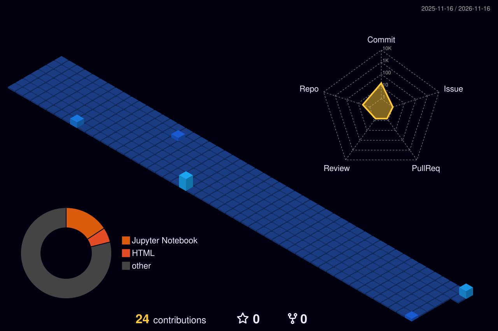

 

  

---

## About Me

I'm a **Data Science & Big Data Analytics** graduate student who turns raw, messy data into decisions that actually matter. I build end-to-end data pipelines, apply machine learning algorithms, and extract patterns that businesses can act on.

Currently pursuing my **MSc in Big Data Analytics**, I work on everything from market basket analysis to geospatial aggregation — practical, exam-ready, and interview-proven projects.

> *"Data is not information, information is not knowledge, knowledge is not wisdom."* — I bridge all four.

---

## Tech Stack

---

## Featured Projects

### [Data Aggregation in Data Mining](https://github.com/shrutisangh/data-aggregation)
> *Time & Spatial Aggregation using Python & Pandas*

Demonstrates how raw transactional sales data is summarized using **three aggregation strategies**: basic (sum, mean, count), time-based (monthly/quarterly/yearly), and spatial (region/city). Built as part of MSc Big Data Analytics coursework.

**Stack:** `Python` `Pandas` `Jupyter Notebook`  
**Key Concepts:** `groupby()` `resample()` `agg()` `Time-Series` `Geospatial`

---

### [Association Rule Mining — Apriori Algorithm](https://github.com/shrutisangh/association-rule-mining)
> *Market Basket Analysis to uncover hidden purchase patterns*

Implements the **Apriori Algorithm** on grocery transaction data to discover frequent itemsets and generate association rules (e.g., Bread → Butter). Outputs support, confidence, and lift metrics for business decision-making.

**Stack:** `Python` `Pandas` `mlxtend` `TransactionEncoder`  
**Key Concepts:** `Apriori` `Frequent Itemsets` `Support` `Confidence` `Lift`

---

### [More Projects →](https://github.com/shrutisangh?tab=repositories)

---

## GitHub Stats

 

  

<picture>
  <source media="(prefers-color-scheme: dark)" srcset="./dist/github-contribution-grid-snake-dark.svg" />
  
</picture>

  

---

## Currently Working On

- **Clustering Algorithms** — K-Means, DBSCAN on real-world datasets
- **Predictive Analytics** — Regression & classification models for business forecasting
- **Big Data Pipelines** — Exploring PySpark for large-scale data processing
- Preparing for **data analyst / data scientist** roles

---

## Let's Connect

---

